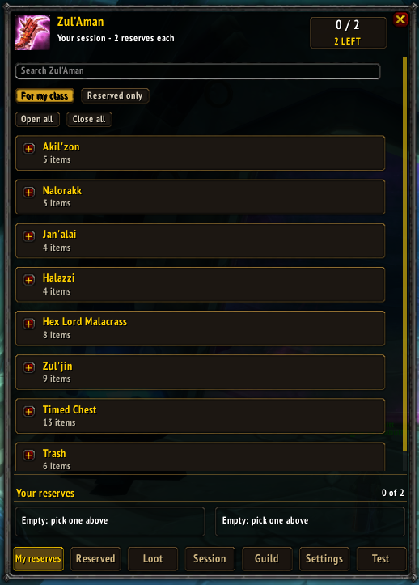
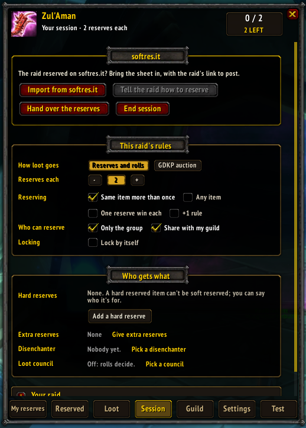
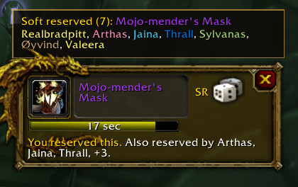
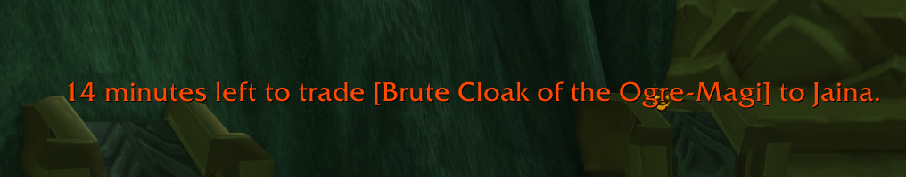
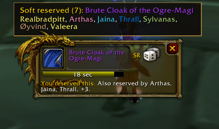
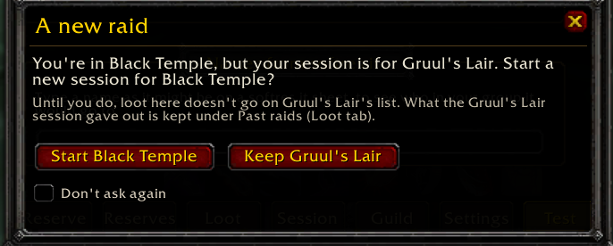

  

  
  
  
   
  
  
  

# LootRuler

  
  
  

**Raid loot, run inside World of Warcraft**, for the **TBC Anniversary** realms. No website, no spreadsheet, no copying names out of Discord. Only the person running loot needs the addon: everyone else can type in raid chat, whisper, or `/roll`.

Type **/lr** in game.

| For | What LootRuler does |
| --- | --- |
| [Pugs](#for-raid-leaders) | Soft and hard reserves, extra reserves for tanks and healers, `!reserve` in raid chat for anyone without the addon, softres.it import, raid setup from a sign-up list, and handing it all to Gargul |
| [Handing out loot](#rolling-out-loot) | Roll windows that know who reserved what, one item or all of them one after another, ties, +1s, your own roll types, a disenchanter, a loot council, loot rules, trade help |
| [Keeping track](#the-raids-loot-list) | The raid's loot list, who has what, exports (spreadsheet, thatsmybis, DFT), an award history by date, past raids, and who got what over time |
| [GDKP](#gdkp) | Auctions bid on in raid chat (one at a time or several at once), max bids and bids ahead, the pot with cuts and rules of your own, a ledger, and payouts |
| [Guilds](#for-guilds) | Boosted rolls with points per raid (alts included), priority lists like a DFT sheet, kept in the game and shared with the guild |
| [Trying it out](#trying-it-out-on-your-own) | A practice raid of made-up players, on your own screen, to try everything before a real raid |

> **Beta.** If something looks off or throws an error, please [say so](https://github.com/kcham01/LootRuler/issues/new?title=Bug:%20&labels=bug), with a screenshot if you can.

## Every raid up to Zul'Aman

Burning Crusade: **Karazhan, Gruul's Lair, Magtheridon's Lair, Serpentshrine Cavern, Tempest Keep, Mount Hyjal, Black Temple, Zul'Aman** and the Outland world bosses.
The original raids, still there in TBC: **Molten Core, Onyxia's Lair, Blackwing Lair, Zul'Gurub, Ruins of Ahn'Qiraj, Temple of Ahn'Qiraj** and the Azeroth world bosses.

Every boss's loot in kill order, with trash drops, patterns, books, tier tokens, boss heads (the right one for your faction) and Zul'Aman's timed chests: 1,446 items. Items show with the game's own icons, tooltips and quality colours, and every list can be searched, in one raid or all of them, with or without a session open. (Naxxramas isn't there: the original 40-player Naxxramas can't be entered in TBC.)

## For raid leaders

1. **Open reserves** on the Session tab: pick the raid (the one you're in is picked for you), how many soft reserves each player gets, whether a player can put more than one on the same item (on by default), and whether to share the session with your guild so people can reserve before the group is even made.
2. **Hard reserve** anything: say who it's for and add a note if you like. Anyone who had soft reserved it gets that reserve back.
3. **Extra reserves** for tanks, healers or anyone: on the Session tab (or a player's row on the Reserved tab), pick the players and how many more they get. `!lr` tells players without the addon how many they have.
4. **Reserve yourself** on the My reserves tab, like everyone else.
5. **Post in raid chat** tells everyone how to reserve, addon or not. **Remind** names who hasn't reserved in raid chat, with how to. Switch on "Tell people who join how to reserve" (Settings) and anyone joining later hears it too.
6. **Watch it fill up** on the Reserved tab, by item (boss by boss: each opens with a click, and a search opens every boss with a match) or by player, with who in the group hasn't reserved yet. Take reserves away or add them for people who can't (pick all of someone's items in one go).
7. **Lock** when you're ready, or have them **lock by themselves** in 10 to 60 minutes or at a time you pick (the raid is told 5, 2 and 1 minute before, with how to reserve). Locking puts the reserves into Gargul (if it's loaded). Or **Send to Gargul** any time, or **Copy for Gargul** to paste into Gargul's importer (`/gl sr`) on the character running loot.
8. **Leaving, or the leader dropped?** **Hand over the reserves** (at the top of the Session tab, beside Import, Tell the raid how to reserve and End session). If the leader leaves or goes offline, the raid leader or the master looter can take them over (or pick who does). Everything reserved and given out stays, and the raid is told who to whisper now.
9. **Only the group can reserve** (on to start with): players outside the group are told to ask for an invite first. You can still add reserves for anyone, and imports still come in. Switch it off on the Session tab to let guild members reserve before the raid forms.

  
  
  

**One reserve win each** (Session tab): once a player wins one of their reserves, their other reserves stop counting, so loot goes further. The raid is told when it happens.

  

**Swapping a reserve after they're locked:** a raider asks (My reserves tab, "Ask to swap one", or whisper `!reserve swap [old] [new]`), the leader allows or refuses it on the Reserved tab, and the raider is told by whisper.

**Clearing reserves of players who left:** the Reserved tab (under More) shows how many players have reserves but aren't in the group, and one button (after a check that names them) takes their reserves off, so their items are free for the rest. Someone offline but still in the group keeps theirs.

  
  

**Raid setup** (Session tab, under Your raid, or `/lr raid`): paste who's coming, from raid-helper, a spreadsheet or anywhere (one name per line, or names with commas; class and spec words are skipped). LootRuler shows who's here, who's missing and who's in the group but not on the list. **Invite** the missing (a party becomes a raid when it needs to), **Say who's missing** in raid chat, and **Sort into groups**: put "Group 1", "Group 2"... before names in the list and the raid is moved to match.

**Your raid** (Session tab): give your raid a name, a short message (where to sign up, your rules) and an icon. Raiders with LootRuler see it in their window, the raid hears it when you post the reserves, and it's kept for your next session.

  
  

**Bag checks** (Loot tab, under More, or `/lr bags`): pick some items (a flask, a key, an attunement item) and ask the group. Everyone with LootRuler answers with how many they carry, in bags and bank. The report shows who has none, and who can't be asked (no LootRuler). One click names who's missing what in raid chat. Answering can be switched off in Settings.

**Raid gear** (Loot tab, under More, or `/lr gear`): everyone in the group in one list, best item level first, with how many items and when it was read. A click shows what they wear, slot by slot. Everyone is read with the game's own inspect, one at a time, when they're close and out of combat, so nobody can make their gear up.

  
  

Already used softres.it, or some of the raid did? **Import from softres.it** brings in its "Gargul Export", on top of the reserves made in LootRuler. Import it again whenever the sheet changes: the reserves from the sheet are updated to match it (swaps, removals, hard reserves), and reserves made only in LootRuler stay. An item someone reserved in both places counts once, and follows the sheet if they change it. Nobody ends up with more reserves than they should: a pick that has already won its item stays, and anything past someone's limit is skipped. Names on the sheet are matched to the characters in the group: capitals and accents don't matter ("Ghost" on the sheet is your "Ghøst"), and a name typed without its realm finds a player from another realm. A name that could be two players, or a typo nobody in the group has, is listed with a one-click fix ("Bobb -> Bob-Faerlina"). Someone who joins later gets their reserves as soon as they're in. A spreadsheet works too: softres.it's CSV export, or any sheet with a column for the player's name and one for the item's number. The softres.it export also brings the raid's softres.it link, and **Post the softres.it link** (Session tab) puts it in raid chat for players who'd rather reserve there.

  
  

**A raid LootRuler doesn't know yet** (a brand new one, or *World of Warcraft: Forever*'s): pick **Another raid** and name it. Any item can be reserved for it: shift-click the item into the search box, or whisper its link. For a raid it does know, **Any item** lets people reserve loot its lists don't have yet. Either way, it's the leader's addon that decides what can be reserved, so raiders with an older version of LootRuler can still reserve everything.

## For raiders

- **With the addon:** a message tells you when your leader opens reserves. Type **/lr**, open a boss, click an item to reserve it, right-click to take it back. The list only shows what your class would wear unless you switch "For my class" off. If the leader is offline, your picks wait and go to them when they're back. Reserves opened by someone who isn't the raid leader or master looter don't take over your window: you're asked "Join their reserves?" first.
- **Not running loot, and nobody running it has LootRuler?** Open a **private session** (Session tab, under Open reserves, or "Import it just for me" on the first screen). It keeps the raid's loot list (from the game's loot lines and Gargul's awards) and the reserves you import from softres.it, on your screen only: nothing is sent to anyone or said in chat. Closing it forgets it. When the loot master opens LootRuler reserves you're asked to join, and joining closes it.
- **When the loot master picks up loot**, a small note at the top of your screen lists each item and who reserved it ("Yours", or "SR: Ann, Bob"). It needs no clicks and goes by itself.
- **Without the addon:** type in raid chat, or whisper the leader. The answer comes by whisper.

  
  
  
   
  
  

Every command starts with `!reserve` or `!lr` (the same thing; the raid is taught `!reserve`, and any capitals work).

| Type (raid chat or whisper) | Does |
| --- | --- |
| `!reserve <item link or name>` | reserves it (several links in one whisper reserve each) |
| `!reserve remove <item>` | takes a reserve back |
| `!reserve clear` | takes all of them back |
| `!reserve` | tells you what you have reserved (and how many you get, extras included) |
| `!reserve swap <old item> <new item>` | once reserves are locked: asks the leader to swap one (also `!reserve swap old for new`) |
| `!lr points` | your boosted roll points, and what to `/roll` with them (when the raid uses them) |
| `!lr prio` / `!lr prio <item>` | your places on the guild's priority lists, or who's on an item's list |
| `!lr vote <name>` | on the loot council: your vote on who gets the item up now |
| `!lr bid 150` | a GDKP bid (or just type `150` in raid chat) |
| `!lr max 800` | a GDKP max bid: LootRuler bids for you, up to 800g |
| `!lr bid #2 300` / `!lr max #2 800` | the same, on item 2 of several auctions at once (or type `#2 300` in raid chat) |
| `!lr bid 300 <item>` / `!lr max 800 <item>` | a bid ahead on an item waiting in the auction queue |
| `!lr pot` | in a GDKP: what you owe the organiser, or what they owe you |

(`!sr` is left alone: Gargul answers that one.)

## Rolling out loot

When it's time to hand out loot, LootRuler pops up a roll window for everyone, like the game's own Need/Greed window, and it knows who reserved what.

  
  
  

- **The loot master** opens a corpse with master loot on and LootRuler lists what's in it beside the loot window, with who reserved each item. The raid hears it too, once per corpse: each epic, and anything reserved, with who reserved it. Click one to roll it out, or **Roll them all out** to put every item up one after another. **Ctrl+Alt+click** any item (in your bags, the loot window or a chat link), or type `/lr roll` and an item link. (The shortcut can be changed to Alt+click, Gargul's, on the Settings tab.)
- **Everyone with LootRuler** gets a roll window: the dice is main spec (`/roll`), the coin is off spec (`/roll 99`), the x passes. It shows the timer, the best rolls so far with who rolled them (only the ones that count, so a roll on a reserved item from someone who didn't reserve it isn't listed), then who won.
- **Players without the addon** are told in raid chat what to roll, and their `/roll`s count the same.
- **A soft reserved item** is only rolled for by the players who reserved it, and who are in the raid. Everyone else sees who reserved it, and their window won't let them roll. **Reserved it more than once?** You roll once for each reserve and your best roll counts: with x3 you /roll three times (the raid's line says "x2 rolls twice, best counts", and your window says how many rolls are left). Once a reserve has won its item it's used up, so if a second one drops it goes to the next reserver.
- **A hard reserved item** isn't rolled for at all: the loot master gets a "Give to" button.
- **A tie** can be rolled again, just between the players who tied.
- **The countdown, and who won:** raid chat hears "You have 10 seconds to roll on [item]." with 10 seconds left, then the last five are counted down ("5...", "4...", "3...", "2...", "1..."). Then nothing is said until the loot master has checked the rolls and clicked **Give** (or **Award**): that line says who won, with their roll ("Pug has won [item] (MS roll 85)."), and if it isn't the best roll, that it was the loot master's pick (or the council's choice). Raiders' windows wait for it too. Both can be turned off in Settings: one "5 seconds left" line instead of the countdown, and the winner said as soon as rolls close.
- **Giving it out:** the loot master's window lists every roll, best first, and the ones that don't count (wrong roll, didn't reserve it, too late) underneath. One click gives the item to the winner through master loot. The item, the winner and how they won it go on the Loot tab's list of loot given out.
- **Give it without a roll:** the loot panel's **Give** (or clicking an item on the Loot tab) picks who gets it and how (main spec, off spec, their reserve, or to disenchant). It's recorded and announced like a won roll.
- **Gave it to the wrong player?** **Undo** in the loot master window takes it back off the list, and the roll is as it closed: give it to someone else or roll it again. If the item already went to them, the raid is asked for them to trade it on.
- **When the game won't hand it over** (their bags are full, it's unique and they have one, they're too far away): the award is taken back, the raid hears the item is still to give out, and the loot master is told why.
- **A disenchanter** (the leader picks them on the Session tab, or `/lr de [name]`): when nobody wants an item, the loot master's window has a one-click **Disenchant** button that gives it to them and tells the raid.
- **The +1 rule** (the leader turns it on for a session): every item won on a main spec roll is a +1, and players with fewer +1s win main spec rolls over players with more. The raid is told when a roll starts, roll windows and the loot master's window show who has a +1, `!lr` tells players their +1s, and the leader can give or take +1s on the Reserved tab.
- **Your own kinds of roll** (the loot master's Settings tab, "Roll types"): add Transmog (`/roll 98`) in one click, or up to four of your own, each with its own number. They count after off spec, in the order listed. Raid chat says how to roll for each, and roll windows get a button for each. Players without LootRuler just type the `/roll`.
- **Item notes** (Settings, "Item notes"): your own note on an item, like "Warrior > Rogue". Rolling it out adds it to the raid chat line ("Note: Warrior > Rogue."), everyone's roll window shows it, and you see it in the item's tooltip. Kept between raids; copy them out or paste a list in ("28525: Warrior > Rogue", one a line).
- **thatsmybis wishlists** (Settings, "thatsmybis wishlists"): paste your guild's thatsmybis download. When an item is rolled out, raid chat and everyone's roll window say who in the group wishlisted it ("Wishlisted: Ann (1), Bob (2)."), and so do the corpse loot posts and the item's tooltip. Anyone already given the item is left out.
- **What they wear now:** when someone rolls, the loot master's addon looks at what they wear in that slot with the game's own inspect (when they're close, and not in combat), and shows its icon beside their roll (hover for the item). Raiders' own roll windows say "You have: ...". Nothing a raider's addon says about their gear is used, so it can't be made up. (A setting, on to start with.)
- **Your item is up:** when an item you reserved (or are first on the priority list for, or have on your thatsmybis wishlist) is rolled out, you're told in the middle of your screen, with a sound, and the game's icon flashes if you're in another window.
- **Roll window options** (Settings tab): leave out items your class can't use, close the window once you've rolled, and make windows smaller or bigger.

  
  
  

**Loot council:** pick a council on the Session tab, and they vote on who gets each item from the players who roll for it (a "Council" button on their roll window, or whisper `!lr vote Name` without the addon). The loot master sees the votes and the council's choice, and hands it over. Votes stay between the council and the loot master.

  
  

**Holding and trading items:**

- **Trade timers** (switch them on in Settings): a small window for the loot master with a bar for each item in their bags still to roll out or trade, and how long is left of the 2 hours (green, then yellow at 30 minutes, red at 15). Click one to roll it out, or, once it's won, to open a trade with the winner. Right-click to give it without a roll. Drag it anywhere. The x hides it until another item comes in. **Post** (or `/lr held`) puts the list in raid chat, with the time left on each.
- **The 2 hours to trade:** for items the loot master is holding, a message in the middle of their screen 15 minutes before they can't be traded any more, and again at 5: which item, who it's for, or that it hasn't been rolled out yet.

**Other ways loot is handed out:**

- **Group loot** (no master looter): switch on "Count group loot wins as given out" and epics won with the game's Need / Greed go on the list of loot given out (their reserve if they had one on it).
- **Given out without LootRuler?** If the loot master hands an item out with the game's own loot menu, LootRuler asks whether to put it on the list of loot given out, and how they got it (their reserve, main spec, off spec or to disenchant). It's then announced and tracked like any other award. (A setting, on to start with.)
- **Becoming the master looter:** LootRuler asks whether to open the loot master window, and offers to tell the raid in one line who runs loot and how to roll. You can turn the question off, or have the raid told by itself (Settings tab).

  
  
  

  

**Who reserved it, while it's rolled for:** a small strip above the roll window lists everyone who reserved the item, every name in full and in class colours, and goes when the roll ends. It works for Gargul's rolls too: LootRuler reads Gargul's line in raid chat ("You have 20 seconds to roll on ..."), so raiders with LootRuler see the reserves whoever runs the roll. Raiders who don't have Gargul also get a roll window for Gargul's roll, like LootRuler's own: its dice and coin just /roll for Gargul to count, it shows everyone's rolls, and it says who Gargul gave the item to. When Gargul says who an item was awarded to, the leader's LootRuler puts it on the Loot tab as given out (their reserve if they had one on it, off spec if Gargul's line says so), and Gargul's "I gave [item] to ..." marks it handed over. Gargul's lines only count from whoever runs loot, so nobody can type them to fake a roll or an award. Each of these can be turned off (Settings tab).

**Your reserves where you see items:** the game's own loot window and need/greed windows glow on items you reserved, and every item tooltip (bags, chat links, loot windows) says who reserved it and who it went to. With Gargul loaded, tooltips leave the reserves to Gargul, so they aren't listed twice. The loot window also marks every reserved item (SR, or HR) with who reserved it, for everyone.

  
  

**Need and Greed:** your own rules for the game's Need / Greed windows when the group isn't on master loot (Settings tab, off to start with): "greed on green items", "pass on blue items", "need on this item". LootRuler rolls what the first matching rule says and tells you; a roll the game won't allow is left to you. Switch on "Don't ask 'this item will bind to you'" and the game's question is answered yes, only for rolls your rules make.

**Auto-roll:** your own rules for roll windows (Settings tab). "Always pass on this item", "always roll main spec on that one", and "pass on anything my class can't use". Shift-click a roll window's dice, coin or x to make it a rule. LootRuler rolls or passes for you and says so.

## The raid's loot list

The **Loot** tab lists the raid's loot as it drops, boss by boss, for the whole raid to see, with the game's icons, tooltips and quality colours: who reserved it, whether it's still on the corpse or being rolled for, who won it and how, and who has it now. Your own wins and reserves stand out. When the session ends it moves to the **Award history** (below).

**Only the raid's loot is listed:** gear (and tier tokens), mounts, recipes (plans, schematics, formulas, patterns, designs), and a short list of other raid loot: Mark of the Illidari, Heart of Darkness, Black Temple's epic gems, Nether Vortex, Vashj's Vial Remnant, Black Sack of Gems, the Amani Charms, Amani Hex Stick, Mojo, Soul Essence and Karazhan's library books. Things like Nether Vortexes are counted at the bottom ("Everything else that dropped": how many, and who looted them) and are never announced or held to roll out. Cloth, trade goods, other gems, potions and gold are left out, and so is anything from a profession (disenchanting, gathering, skinning, fishing). A session only takes loot from inside its own raid: going into a different raid, or into its raid on a new lockout, asks whether to start a new session there.

  
  
  

- **Roll now or at the end.** The loot master can roll an item out as soon as it drops, or give it to themselves, keep going, and roll it out from the Loot tab later. The game lets you trade raid loot for 2 hours after you loot it, so the list shows how long is left.
- **Trade help.** Switch on "Open a trade with the winner" (Settings, off to start with) and giving out an item the loot master is holding opens a trade with the winner when they're close (too far away, they're whispered to come and trade). Switch on "Put won items in trades for me" too, and when the trade opens (either of them can open it), LootRuler puts their item in the trade window. When the trade goes through, the list shows they have it. A "To trade" list shows the loot master what they still have to hand over. You can turn this off.
- **Any loot method.** With master loot the loot master's addon writes down each corpse's loot (opening a corpse again doesn't list it twice). With group loot the leader's addon writes down the epics people loot. If the master looter doesn't have LootRuler, the leader's addon lists what they give out from the game's loot lines. When whoever holds a won item doesn't have LootRuler, the list just says who won it ("Won by Ann"): a trade is only seen by the two players in it.
- **Mistakes:** the leader can right-click an item to take it off the list, or take an award off.
- **Change an award** (the leader): click a given-out item on the Loot tab to change who got it, or how (their reserve, main spec, off spec, to disenchant). The raid is told, and reserves used, +1s and who has it to trade follow.
- **Loot rules** for the master looter (Settings tab, off until you turn them on): "green items to the disenchanter", "recipes and patterns to me", "this item to Ann", "anything below epic to everyone in turn", or "leave this item alone". They're applied when you open a corpse; anything someone reserved is always rolled for instead. **Pick up the gold** (its own switch) takes a corpse's gold, which the game shares out.
- **Trade announcements:** while you're running loot, a line in raid chat says what you traded and to whom ("Traded [item] to Ann for 150g.", "Traded [item] x3 to Ann."), so nobody wonders where an item went. Enchanting someone's item in a trade is said too, with what they paid ("Enchanted Ann's [item] (Enchant Bracer - Superior Healing) for 5g."); if you're not running loot, you get it as a note in your own chat. In a GDKP, gold paid for an enchant doesn't count towards the pot. Out of a group nothing is said (the game only lets an addon talk in /s after a click). You can turn it off.
- **Tell the guild** (Settings, off to start with): each item given out also gets a line in guild chat, with the raid's name ("Karazhan: [item] goes to Ann (MS 85)."), and so does one taken back.
- **Export** who won what, to paste into a spreadsheet, thatsmybis or a DFT sheet, or **post it in raid chat** so everyone (addon or not) sees the list. **Your own** layout writes each line the way you want it (`{date};{player};{item};{how}`, with the raid, boss, roll and more), and **Export several raids** (in the Award history) puts the last 7, 30 or 90 days, or everything, into one list.

  
  
  

**Award history** (the Loot tab's second page, or `/lr history`): everything given out in your raids, by date, newest first. Each date opens with a click to show what was given out that day, who won it, how, and in which raid. **Past raids** is there too: when a session ends, what it gave out is kept (the last 30 raids, on each character that was there), with the loot list, the export, and a GDKP's payouts. In a GDKP, the loot panel says what an item sold for before.

**Who got what, over time** (in the Award history, or `/lr fair`): everyone's loot over the last 4 weeks, 3 months or all your past raids, most items first: what kind (reserved, main spec, off spec, bought, disenchanted), how many raids they came to, and when they last got something. A click lists their items.

  
  
  

## GDKP

Pick **GDKP auction** for how loot goes (Session tab) and every item is auctioned for gold instead of reserved and rolled for. Nobody needs the addon to bid.

  
  

- **Auctions:** the loot master clicks an item, or **Auction them all** to put every item up one after another. The raid is told where bids start and by how much each must go up. Players bid by **typing an amount in raid chat** ("150", "150g", "1.5k"), by whispering `!lr bid 150`, by clicking one of the two bids in their auction window, or with **Bid an amount** in it (any amount, in a box: it's typed in raid chat for them). A bid in the last few seconds gives everyone a few more. A bid that's too low doesn't count, and its bidder is told the lowest that would. If people chat numbers during auctions, switch on **Bids start with "bid"**: then only "bid 150" counts, not "150".
- **For bidders:** a message in the middle of your screen and a sound when someone outbids you (with the bid that wins it back), and your auction window shows what's coming up next. The raid hears a final call with 10 seconds left, and each sale ends with the pot so far.
- **Max bids:** "bid for me up to 800g". Shift-click a bid in the auction window, type `/lr max 800`, or (without the addon) whisper the leader `!lr max 800`. LootRuler bids for you as little as it takes to keep you on top, up to that, and nobody else sees your max. When two maxes meet, the higher one wins; equal ones go to whoever set theirs first.
- **Bidding ahead:** while items wait in the auction queue, raiders bid ahead from their roll window ("Bid ahead"), or by whispering the loot master `!lr bid 300 [item]`. When the item comes up, LootRuler bids for them, as little as it takes, up to that.
- **Several auctions at once:** put up to 12 items up together ("Auction them together" by the loot window, "Auction several at once" for the items you hold, or `/lr batch`), ending together. Raiders bid by typing the item's number and the gold in raid chat ("#2 300"), with the auction window (its buttons, or **Bid an amount** on any item), or by whispering `!lr bid #2 300` / `!lr max #2 800`. A bid at the last moment gives everyone a few more seconds. Each item with a bid is sold and handed out like any other sale.
- **Sold:** the highest bid when time is up buys the item, which goes to them through master loot (or is marked for a trade). Nobody bids: it stays on the Loot tab to roll out or disenchant later, and the next item comes up. A hard reserve still comes first.
- **Bids not taken** (optional): someone who won't pay? Right-click them in the loot master window to stop taking their bids for the rest of the night. Their bids (in raid chat, by whisper, or max bids) don't count, the best of everyone else's is top again, and the raid is told once. The GDKP panel lists them, each with an x to take it back.

  
  
  

- **Prices:** where bids start and the least raise, for the whole raid, and a different start for any item you like. **Starting bids in and out** copies them all as text, or brings a list in ("28525: 500", one item a line).
- **Sales:** every sale listed, to change a price (a mistake, or a discount) or take a sale back. The pot and the split follow.
- **The pot:** the organiser's cut (0 to 20%), a cut for each tank and each healer (a percent of the pot each; pick who on the GDKP panel's **Tanks and healers**), bonuses for anyone you like, and an even split between everyone who was in the group, plus anyone who bought something. Anyone can be left out of the split.
- **Pot rules of your own:** name a cut, give it a percent of the pot, gold, or both, and pick who gets it ("Raid leader: 5%", "Pumper: 500g"). Rules are paid out of the pot before the even split, and `!lr pot` and the raid's summary name them.
- **Bookkeeping:** put gold in the pot by hand or take it out (vendor money, repairs), with what for; a ledger of every sale and payment (trades, mail, marked as settled) with its time; the payouts copied out for a spreadsheet or as "Name,Gold" lines, and payouts brought back in to pay those amounts instead (everyone else splits the rest).
- **Ending the raid:** while anyone still owes gold or is owed some, ending the session asks first. Either keep it open (it stays for a week), or end it: it's kept under **Past raids**, where the payouts can be finished, and trades with them still count for two weeks.
- **Payouts:** addons can't put gold in a trade, so when the organiser opens a trade LootRuler says what to give or take, and counts the gold that changes hands. **Tell the raid** posts the pot in raid chat; **Whisper everyone** tells each player what they owe or are owed; `!lr pot` asks for it. **By mail:** at a mailbox, with the Send Mail tab open, **Mail Ann 405g** fills in the next payout (name, subject, gold) for you to check and send; once it's sent, it counts as paid.

  
  
  
   
  

## For guilds

Guild members get a **Guild** tab: things that last between raids, kept by the officers and shared with everyone in the guild who has LootRuler. Nothing here shows up for pugs, and nothing is used until an officer turns it on.

  
  

- **Who can change it:** the guild master picks the lowest rank that can (officers to start with). Everyone else can see it. Two officers changing it at once don't undo each other's changes.
- **Boosted rolls:** guild members get points for each raid they come to (5 to 25 a raid, the officers choose). With boosted rolls on for a session, a player with 30 points can roll 31 to 130 on main spec instead of 1 to 100. If they win with it, their points are spent. Roll windows get a green dice for it; players without the addon are told what to type in raid chat (`/roll 31 130`) and can whisper `!lr points` to ask what they have.
- **Alts** share their main's points, as in Gargul: an alt rolls boosted with them, and spends them if it wins. A main and their alt in the same raid get its points once. Officers link alts on a player's points (Edit), and Gargul's alts come in with its points. `!lr points` from an alt says whose points they are.
- **From Gargul:** officers can bring boosted roll points in from Gargul (read straight from it if it's loaded, or paste its export) and copy them back out. A raid leader can do the same with Gargul's +1s on the Session tab.
- **Raid points:** an officer gives them from the Session tab, or when ending the session. Everyone from the guild in the group gets them, and the raid is told. **The bench** (Session tab, in Boosted rolls): guild members who came but sat out get the raid's points too, and count as there in "Who got what, over time".
- **Priority lists** (like a DFT sheet, kept in the game): officers put players on an item's list in order (players can share a place), or bring the lists in from the DFT sheet, thatsmybis or Gargul's CSV, and copy them back out. On the Session tab, loot goes by **reserves**, **priority lists, then reserves**, or **priority lists only**. The best place in the raid gets the item with no roll; players who share it roll for it, and their roll windows say so. Whoever gets it comes off the list, for the whole guild. Item tooltips show the list, and players without the addon whisper `!lr prio` (their places) or `!lr prio [item]` (an item's list).

  
  
  

## Trying it out on your own

**The Test tab** (switch it on in Settings): a **practice raid** you run on your own, with up to 12 made-up players who reserve (by whisper and in raid chat), roll, pass and bid on LootRuler's real rules and screens. Have a boss drop loot, roll it out, give it out, have a raider ask to swap a reserve once they're locked or leave the group with their reserves, try a tie, a GDKP auction, several auctions at once, a loot council, priority lists or boosted rolls. What the raid would hear shows only in your chat, nothing is sent to anyone, and the practice raid is forgotten when it ends (joining a group ends it). Out of a group the game doesn't show you your own raid chat, so `/lr say <text>` types a line into the practice raid's chat (a bid, say).

Also on the tab: pretend LootRuler and Gargul rolls with as many made-up reservers as you like, the trade warning and the reminder, and a box to try a softres.it name against your group. Everything on it happens only on your screen. `/lr test` shows a pretend roll window so you can drag it where you want it.

  
  
  

## Settings and getting started

Whoever runs loot needs LootRuler: the master looter, or the raid leader without master loot (assistants don't count: pugs often make everyone one). Raiders don't need it, but it's nicer if they have it. The Settings tab has every option, each saying what it does, and can turn roll windows off, or show them only for items you can roll on. Its sections are listed down the side, under three headings (for everyone, running loot, more), and the one you pick is shown beside them, saying what's in it ("Auto-roll: no rules yet"); the list scrolls on its own. **All settings** shows everything at once, and the search box finds a section.

- **Getting started:** the first time you open LootRuler, a five-page tour shows where everything is (`/lr tour` any time). After an update, one chat line says there's something new (`/lr whatsnew`).
- **Themes** (Settings, Themes): how LootRuler looks. **Classic** is the game's own look: stone frames, gold title plates and red buttons. **ElvUI** is flat and dark, with thin black edges, gold for what's picked and a narrow font, to sit beside ElvUI. A theme changes only the look, never where anything is or what it does, and comes in with a reload. Both are drawn with the game's own art and font: nothing from ElvUI is in LootRuler.
- **Profiles** (Settings tab) save all your settings under a name, to switch between, say, "Running loot" and "Raiding".
- **Sounds:** one switch turns all of LootRuler's sounds off, and you pick which of the game's sound channels they play on.
- **Who has LootRuler** (`/lr versions`, or Settings): everyone in the group with their version, older ones first. It can ask everyone again, and whisper those with an older one that a newer one is out.

  
  
  

  
  
  

## Every screen

The pictures here are drawn by the tests on every build, from the addon's own code, in a stand-in for the game, so they always show
the latest version. Some pictures further up are screenshots from the game itself (`docs/screens`). The ones named
`elvui-...` show the ElvUI theme.

Show all 135 screens

<table>
<tr><td width="33%" align="center"> empty</td><td width="33%" align="center"> raid-dropdown</td><td width="33%" align="center"> browse</td></tr>
<tr><td width="33%" align="center"> new-session</td><td width="33%" align="center"> reserve-bosses</td><td width="33%" align="center"> reserve</td></tr>
<tr><td width="33%" align="center"> search</td><td width="33%" align="center"> pick</td><td width="33%" align="center"> hard-reserve</td></tr>
<tr><td width="33%" align="center"> auto-lock</td><td width="33%" align="center"> session</td><td width="33%" align="center"> reserves</td></tr>
<tr><td width="33%" align="center"> by-player</td><td width="33%" align="center"> reserve-for-player</td><td width="33%" align="center"> copy</td></tr>
<tr><td width="33%" align="center"> import</td><td width="33%" align="center"> import-names</td><td width="33%" align="center"> import-names-by-player</td></tr>
<tr><td width="33%" align="center"> import-csv</td><td width="33%" align="center"> raider</td><td width="33%" align="center"> raider-waiting</td></tr>
<tr><td width="33%" align="center"> raider-session</td><td width="33%" align="center"> loot-panel</td><td width="33%" align="center"> picked-up</td></tr>
<tr><td width="33%" align="center"> give</td><td width="33%" align="center"> roll-window</td><td width="33%" align="center"> roll-list</td></tr>
<tr><td width="33%" align="center"> loot-master</td><td width="33%" align="center"> rolls-closed</td><td width="33%" align="center"> given</td></tr>
<tr><td width="33%" align="center"> roll-windows</td><td width="33%" align="center"> loot-tab</td><td width="33%" align="center"> loot-tab-counted</td></tr>
<tr><td width="33%" align="center"> change-award</td><td width="33%" align="center"> export</td><td width="33%" align="center"> loot-tab-raider</td></tr>
<tr><td width="33%" align="center"> loot-window-reserves</td><td width="33%" align="center"> reserve-strip</td><td width="33%" align="center"> settings</td></tr>
<tr><td width="33%" align="center"> loot-rules</td><td width="33%" align="center"> roll-types</td><td width="33%" align="center"> roll-types-window</td></tr>
<tr><td width="33%" align="center"> plus-ones</td><td width="33%" align="center"> end-session</td><td width="33%" align="center"> any-item</td></tr>
<tr><td width="33%" align="center"> bench</td><td width="33%" align="center"> guild</td><td width="33%" align="center"> boosted-roll</td></tr>
<tr><td width="33%" align="center"> priority-list</td><td width="33%" align="center"> guild-priority</td><td width="33%" align="center"> guild-priority-export</td></tr>
<tr><td width="33%" align="center"> priority-roll</td><td width="33%" align="center"> auction-window</td><td width="33%" align="center"> auction-master</td></tr>
<tr><td width="33%" align="center"> payouts</td><td width="33%" align="center"> gdkp-end</td><td width="33%" align="center"> gdkp-panel</td></tr>
<tr><td width="33%" align="center"> gdkp-sales</td><td width="33%" align="center"> gdkp-prices</td><td width="33%" align="center"> gdkp-mail</td></tr>
<tr><td width="33%" align="center"> gdkp-gold</td><td width="33%" align="center"> gdkp-ledger</td><td width="33%" align="center"> gdkp-payouts-set</td></tr>
<tr><td width="33%" align="center"> no-bids</td><td width="33%" align="center"> gdkp-no-bids</td><td width="33%" align="center"> bid-ahead-window</td></tr>
<tr><td width="33%" align="center"> bid-amount</td><td width="33%" align="center"> bid-ahead</td><td width="33%" align="center"> batch-sheet</td></tr>
<tr><td width="33%" align="center"> batch-window</td><td width="33%" align="center"> batch-master</td><td width="33%" align="center"> bag-check</td></tr>
<tr><td width="33%" align="center"> raid-gear</td><td width="33%" align="center"> raid-gear-player</td><td width="33%" align="center"> brand</td></tr>
<tr><td width="33%" align="center"> brand-raider</td><td width="33%" align="center"> council-setup</td><td width="33%" align="center"> council-vote</td></tr>
<tr><td width="33%" align="center"> council-master</td><td width="33%" align="center"> fairness</td><td width="33%" align="center"> fairness-player</td></tr>
<tr><td width="33%" align="center"> swap-ask</td><td width="33%" align="center"> swap-requests</td><td width="33%" align="center"> absent-line</td></tr>
<tr><td width="33%" align="center"> clear-absent</td><td width="33%" align="center"> extra-reserves</td><td width="33%" align="center"> award-history</td></tr>
<tr><td width="33%" align="center"> past-raids</td><td width="33%" align="center"> export-raids</td><td width="33%" align="center"> max-bid</td></tr>
<tr><td width="33%" align="center"> tanks-and-healers</td><td width="33%" align="center"> pot-rule</td><td width="33%" align="center"> pot-rules</td></tr>
<tr><td width="33%" align="center"> from-gargul</td><td width="33%" align="center"> alts</td><td width="33%" align="center"> take-over</td></tr>
<tr><td width="33%" align="center"> hand-over</td><td width="33%" align="center"> test-roll</td><td width="33%" align="center"> test-gargul</td></tr>
<tr><td width="33%" align="center"> new-raid</td><td width="33%" align="center"> test-tab</td><td width="33%" align="center"> practice-start</td></tr>
<tr><td width="33%" align="center"> practice-reserves</td><td width="33%" align="center"> practice-roll</td><td width="33%" align="center"> item-notes-io</td></tr>
<tr><td width="33%" align="center"> roll-note</td><td width="33%" align="center"> roll-twice</td><td width="33%" align="center"> wishlists</td></tr>
<tr><td width="33%" align="center"> roll-wishlist</td><td width="33%" align="center"> master-looter</td><td width="33%" align="center"> record-it</td></tr>
<tr><td width="33%" align="center"> sounds</td><td width="33%" align="center"> roll-options</td><td width="33%" align="center"> running-loot</td></tr>
<tr><td width="33%" align="center"> loot-rule-turns</td><td width="33%" align="center"> group-rule</td><td width="33%" align="center"> raid-setup</td></tr>
<tr><td width="33%" align="center"> versions</td><td width="33%" align="center"> trade-timers</td><td width="33%" align="center"> tour</td></tr>
<tr><td width="33%" align="center"> whats-new</td><td width="33%" align="center"> profiles</td><td width="33%" align="center"> join-reserves</td></tr>
<tr><td width="33%" align="center"> private-session</td><td width="33%" align="center"> private-clear-absent</td><td width="33%" align="center"> join-closes-private</td></tr>
<tr><td width="33%" align="center"> test-tab-buttons</td><td width="33%" align="center"> reserver-offline</td><td width="33%" align="center"> unconfirmed-takeover</td></tr>
<tr><td width="33%" align="center"> elvui-session</td><td width="33%" align="center"> elvui-reserve</td><td width="33%" align="center"> elvui-reserved</td></tr>
<tr><td width="33%" align="center"> elvui-settings</td><td width="33%" align="center"> elvui-end-session</td><td width="33%" align="center"> elvui-roll</td></tr>
</table>

## Install

1. Download [LootRuler.zip](https://github.com/kcham01/LootRuler/raw/results/LootRuler.zip).
2. Unzip it into `World of Warcraft\_anniversary_\Interface\AddOns`, so you have a `LootRuler` folder there.
3. Restart the game (a new addon needs a full restart) and make sure it's ticked in the AddOns list.
4. Type `/lr` or click the note on the minimap.

**Trying a change before it's released:** each pull request's build also makes `LootRulerTest.zip` (a download on the
pull request's run). It unzips into its own `LootRulerTest` folder beside `LootRuler`, keeps its own sessions and settings,
and shows "LootRuler test" in its window, so the real one isn't touched. Turn on only one of the two in the AddOns list.

Only the raid leader (and whoever runs loot) needs an up-to-date LootRuler. Older and newer versions work together, the addon says when someone has a newer one, and the Reserved tab shows the leader who in the group doesn't have LootRuler at all, so they know who'll whisper.

| Command (`/lr` or `/lootruler`) | Does |
| --- | --- |
| `/lr` | opens or closes LootRuler |
| `/lr session`, `/lr reserves`, `/lr loot`, `/lr guild`, `/lr settings` | opens that tab |
| `/lr roll <item>` | rolls an item out (or auctions it, in a GDKP) |
| `/lr master` | brings back the loot master's window |
| `/lr de <name>` | who disenchants what nobody wants |
| `/lr raid` | raid setup: who's coming, invites, groups |
| `/lr bags` | a bag check |
| `/lr gear` | everyone's gear |
| `/lr held` | posts the items you hold, and their time left, in raid chat |
| `/lr max 800` | in a GDKP: bid for you up to 800g on the item that's up |
| `/lr batch` | in a GDKP: several auctions at once |
| `/lr history` | the award history, by date, and past raids |
| `/lr fair` | who got what, over time |
| `/lr versions` | who has LootRuler, and which version |
| `/lr test` | a pretend roll window, to drag where you want it |
| `/lr say <text>` | in a practice raid: a line in its raid chat |
| `/lr tour`, `/lr whatsnew` | the welcome tour; what's new in this version |
| `/lr help` | lists the commands |
| `/lr minimap` | hides or shows the minimap button |

## How it's checked

Every build:

- checks the session rules (limits, extra reserves, doubling up, hard reserves, locking, changing the rules part way), and the rules for rolls, +1s, boosted rolls, priority lists, auctions, max bids and the GDKP pot;
- runs a **whole raid of clients side by side** in a stand-in for the game: the leader, raiders on the same and other realms, a pug whispering, a guild member outside the group, the leader logging out and back in, people joining late, extra reserves, reserves cleared for players who left, and messages from people who shouldn't be able to change things;
- runs the same raid **rolling out loot**: the loot master opens a corpse, raiders roll from their roll windows and a pug types `/roll`, reserved items are only rolled for by their reservers, ties are rolled again, hard reserved items are given straight out, someone is out of range, a master looter who isn't the leader runs the loot (and nobody else can), and every item goes to the right player through master loot; then the raid's loot list: what each corpse dropped, who has it, items kept to roll out later and handed over in trades, group loot, and the raid kept under past raids once it ends;
- runs a **5-player party** on master loot, with a master looter who isn't the party's leader;
- runs a **GDKP raid**: everything auctioned one after another and several at once, bids clicked, typed in raid chat and whispered, a bid that's too low, a bid at the last moment, max bids against each other, bids ahead, an item nobody bids on, a hard reserved item, bids that must start with "bid", the cut, tank and healer cuts, pot rules and the split, gold changing hands in trades, everyone told their payout, and payouts finished after the raid has ended;
- runs a **guild raid**: the guild master, officers, members with and without the addon and someone logging in later; only the ranks the guild master picked can change points (even sending the change themselves doesn't work), raid points reach everyone in the guild, and boosted rolls, clicked and typed, win and spend their points, ties included; priority lists brought in, an item going straight to the first on its list, two who share a place rolling, winners coming off the lists everywhere, a raid that goes by priority lists only, alts sharing their main's points, and points and alts brought in from Gargul;
- runs the **practice raid** from start to end, with its made-up players reserving, rolling, bidding and voting, and checks nothing is sent to anyone;
- checks the reserves LootRuler hands to **Gargul** are in exactly the layout softres.it publishes for it (doubled reserves, classes, hard reserves, players from other realms), and reads softres.it's exports back;
- checks the addon only uses what the TBC Anniversary client has, against Blizzard's own interface code;
- clicks through every screen, checks nothing errors or leaks frames, and draws every screen.

What LootRuler protects against (someone faking a roll, an award or a reserve list): [docs/exploits.md](docs/exploits.md).

A benchmark (`tools/bench.lua`, not run on every build) plays a 40-player raid night and measures the work, messages and memory of each moment; what it found and what was made faster are in [docs/benchmark.md](docs/benchmark.md). A stress test (`tools/stress.lua`) goes further: thousands of broken messages of every kind, 40 players rolling 390 times on one item, a night of 320 items, and floods of raid chat.

The loot lists were made from AtlasLoot's raid tables and checked boss by boss against the cmangos TBC database; where they disagreed (Hakkar's off-hand Warblade really drops from Mandokir, for example) the database won. `tools/gen_loot.py` makes them again.

## Licence

GPL-2.0. See [LICENSE](LICENSE).

LootRuler's code is its own. The loot lists are built from AtlasLootClassic's and cmangos' tables, both GPL-2.0 like LootRuler. The libraries in `LootRuler/Libs` keep their own licences (their licence files are included). Nothing from Gargul is used: LootRuler only works alongside it. The download includes the licence and a [NOTICE](NOTICE.txt) listing all of this.

## Credits

| Software / data | Used for | Licence |
| --- | --- | --- |
| [AtlasLootClassic](https://github.com/Hoizame/AtlasLootClassic) | Which items each boss drops, in what order | GPL-2.0 |
| [cmangos tbc-db](https://github.com/cmangos/tbc-db) | Item names, quality and types; checking every loot list | GPL-2.0 |
| [Ace3](https://www.wowace.com/projects/ace3) (AceComm, CallbackHandler, LibStub, ChatThrottleLib) | Addon messages | BSD |
| [LibSerialize](https://github.com/rossnichols/LibSerialize) | Packing addon messages | MIT |
| [LibDeflate](https://github.com/SafeteeWoW/LibDeflate) | Compression for addon messages and Gargul strings | zlib |
| [Gargul](https://github.com/papa-smurf/Gargul) | Nothing: LootRuler contains none of its code, and doesn't download or run it to test. It only works alongside Gargul in the game (handing it reserves, reading its exports) | All rights reserved (its own) |
| [wowsims/tbc](https://github.com/wowsims/tbc) | Icon names for the test pictures (not shipped; `tests/fixtures/icons.lua`) | MIT |
| [Gethe/wow-ui-source](https://github.com/Gethe/wow-ui-source) | Checking the addon against the client's interface code (not shipped) | Blizzard's |

World of Warcraft and The Burning Crusade are trademarks or registered trademarks of Blizzard Entertainment, Inc. LootRuler is a fan-made addon and is not made, endorsed or supported by Blizzard Entertainment. Gargul is a separate addon by its own authors.
