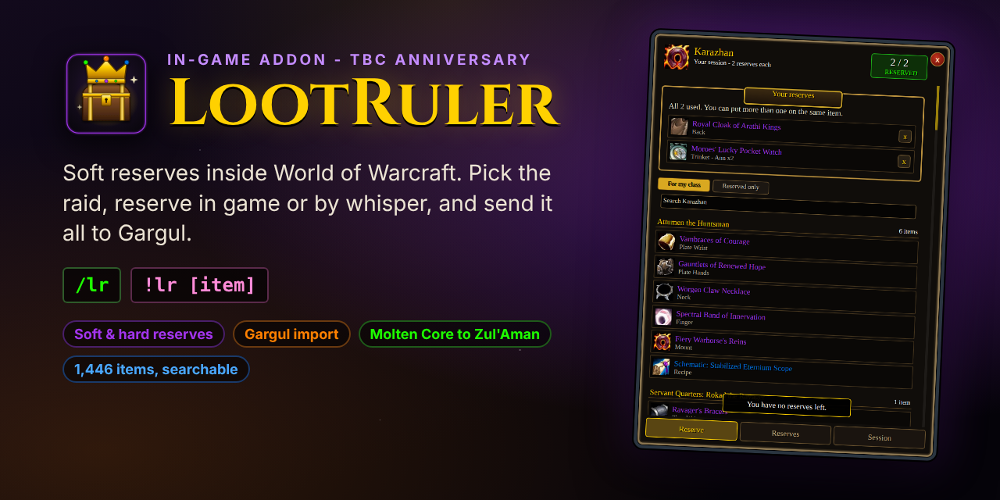

  

  
  
  
   
  
  
  

# LootRuler

  
  
  

**Raid loot, run inside World of Warcraft**, for the **TBC Anniversary** realms. No website, no spreadsheet, no copying names out of Discord. Only the person running loot needs the addon: everyone else can type in raid chat, whisper, or `/roll`.

Type **/lr** in game.

| For | What LootRuler does |
| --- | --- |
| [Pugs](#for-raid-leaders) | Soft and hard reserves, extra reserves for tanks and healers, `!lr` in raid chat for anyone without the addon, softres.it import, and handing it all to Gargul |
| [Handing out loot](#rolling-out-loot) | Roll windows that know who reserved what, one item or all of them one after another, ties, +1s, a disenchanter, loot rules, trade help |
| [Keeping track](#the-raids-loot-list) | The raid's loot list, who has what, exports (spreadsheet, thatsmybis, DFT), and past raids |
| [GDKP](#gdkp) | Auctions bid on in raid chat, max bids, the pot with cuts for the organiser, tanks and healers, and payouts |
| [Guilds](#for-guilds) | Boosted rolls with points per raid (alts included), priority lists like a DFT sheet, kept in the game and shared with the guild |

> **Beta.** If something looks off or throws an error, please [say so](https://github.com/kcham01/LootRuler/issues/new?title=Bug:%20&labels=bug), with a screenshot if you can.

## Every raid up to Zul'Aman

Burning Crusade: **Karazhan, Gruul's Lair, Magtheridon's Lair, Serpentshrine Cavern, Tempest Keep, Mount Hyjal, Black Temple, Zul'Aman** and the Outland world bosses.
The original raids, still there in TBC: **Molten Core, Onyxia's Lair, Blackwing Lair, Zul'Gurub, Ruins of Ahn'Qiraj, Temple of Ahn'Qiraj** and the Azeroth world bosses.

Every boss's loot in kill order, with trash drops, patterns, books, tier tokens, boss heads (the right one for your faction) and Zul'Aman's timed chests: 1,446 items. Items show with the game's own icons, tooltips and quality colours, and every list can be searched, in one raid or all of them, with or without a session open. (Naxxramas isn't there: the original 40-player Naxxramas can't be entered in TBC.)

## For raid leaders

1. **Open reserves** on the Session tab: pick the raid, how many soft reserves each player gets, whether a player can put more than one on the same item (on by default), and whether to share the session with your guild so people can reserve before the group is even made.
2. **Hard reserve** anything: say who it's for and add a note if you like. Anyone who had soft reserved it gets that reserve back.
3. **Extra reserves** for tanks, healers or anyone: on the Session tab (or a player's line on the Reserves tab), pick the players and how many more they get. `!lr` tells players without the addon how many they have.
4. **Reserve yourself** on the Reserve tab, like everyone else.
5. **Post in raid chat** tells everyone how to reserve, addon or not. **Remind who hasn't reserved** names them in raid chat with how to. Switch on "Tell people who join how to reserve" (Settings) and anyone joining later hears it too.
6. **Watch it fill up** on the Reserves tab, by item or by player, with who in the group hasn't reserved yet. Take reserves away or add them for people who can't (pick all of someone's items in one go).
7. **Lock** when you're ready, and the reserves go into Gargul (if it's loaded). Or **Send to Gargul** any time, or **Copy for Gargul** to paste into Gargul's importer (`/gl sr`) on the character running loot.
8. **Leaving, or the leader dropped?** Hand the reserves to someone else on the Session tab. If the leader leaves or goes offline, the raid leader or an assistant can take them over (or pick who does). Everything reserved and given out stays, and the raid is told who to whisper now.
9. **Only the group can reserve** (on to start with): players outside the group are told to ask for an invite first. You can still add reserves for anyone, and imports still come in. Switch it off on the Session tab to let guild members reserve before the raid forms.

Already used softres.it, or some of the raid did? **Import from softres.it** brings in its "Gargul Export", on top of the reserves made in LootRuler. Import it again whenever the sheet changes: the reserves from the sheet are updated to match it (swaps, removals, hard reserves), and reserves made only in LootRuler stay. An item someone reserved in both places counts once, and follows the sheet if they change it. Nobody ends up with more reserves than they should: a pick that has already won its item stays, and anything past someone's limit is skipped. Names on the sheet are matched to the characters in the group: capitals and accents don't matter ("Ghost" on the sheet is your "Ghøst"), and a name typed without its realm finds a player from another realm. A name that could be two players, or a typo nobody in the group has, is listed with a one-click fix ("Bobb -> Bob-Faerlina"). Someone who joins later gets their reserves as soon as they're in.

  
  

**A raid LootRuler doesn't know yet** (a brand new one, or *World of Warcraft: Forever*'s): pick **Another raid** and name it. Any item can be reserved for it: shift-click the item into the search box, or whisper its link. For a raid it does know, **Any item** lets people reserve loot its lists don't have yet. Either way, it's the leader's addon that decides what can be reserved, so raiders with an older version of LootRuler can still reserve everything.

## For raiders

- **With the addon:** a message tells you when your leader opens reserves. Type **/lr**, click an item to reserve it, right-click to take it back. The list only shows what your class would wear unless you switch "For my class" off. If the leader is offline, your picks wait and go to them when they're back.
- **Without the addon:** type in raid chat, or whisper the leader. The answer comes by whisper.

| Type (raid chat or whisper) | Does |
| --- | --- |
| `!lr <item link or name>` | reserves it (several links in one whisper reserve each) |
| `!lr remove <item>` | takes a reserve back |
| `!lr clear` | takes all of them back |
| `!lr` | tells you what you have reserved (and how many you get, extras included) |
| `!lr points` | your boosted roll points, and what to `/roll` with them (when the raid uses them) |
| `!lr prio` / `!lr prio <item>` | your places on the guild's priority lists, or who's on an item's list |
| `!lr bid 150` | a GDKP bid (or just type `150` in raid chat) |
| `!lr max 800` | a GDKP max bid: LootRuler bids for you, up to 800g |
| `!lr pot` | in a GDKP: what you owe the organiser, or what they owe you |

(`!sr` is left alone: Gargul answers that one.)

## Rolling out loot

When it's time to hand out loot, LootRuler pops up a roll window for everyone, like the game's own Need/Greed window, and it knows who reserved what.

  
  

- **Trade timers:** a small window for the loot master with a bar for each item in their bags still to roll out or trade, and how long is left of the 2 hours (green, then yellow at 30 minutes, red at 15). Click one to roll it out, or, once it's won, to open a trade with the winner. Right-click to give it without a roll. Drag it anywhere. The x hides it until another item comes in.
- **The 2 hours to trade:** for items the loot master is holding, a message in the middle of their screen 15 minutes before they can't be traded any more, and again at 5: which item, who it's for, or that it hasn't been rolled out yet.
- **Give it without a roll:** the loot panel's **Give** (or clicking an item on the Loot tab) picks who gets it and how (main spec, off spec, their reserve, or to disenchant). It's recorded and announced like a won roll.
- **Gave it to the wrong player?** **Undo** in the loot master window takes it back off the list, and the roll is as it closed: give it to someone else or roll it again. If the item already went to them, the raid is asked for them to trade it on.
- **The loot master** opens a corpse with master loot on and LootRuler lists what's in it beside the loot window, with who reserved each item. The raid hears it too, once per corpse: each epic, and anything reserved, with who reserved it. Click one to roll it out, or **Roll them all out** to put every item up one after another. **Ctrl+Alt+click** any item (in your bags, the loot window or a chat link), or type `/lr roll` and an item link. (The shortcut can be changed to Alt+click, Gargul's, on the Settings tab.)
- **Your item is up:** when an item you reserved is rolled out, you're told in the middle of your screen, with a sound, and the game's icon flashes if you're in another window.
- **Everyone with LootRuler** gets a roll window: the dice is main spec (`/roll`), the coin is off spec (`/roll 99`), the x passes. It shows the timer, the best rolls so far with who rolled them (only the ones that count, so a roll on a reserved item from someone who didn't reserve it isn't listed), then who won.
- **Your own kinds of roll** (the loot master's Settings tab, "Roll types"): add Transmog (`/roll 98`) in one click, or up to four of your own, each with its own number. They count after off spec, in the order listed. Raid chat says how to roll for each, and roll windows get a button for each. Players without LootRuler just type the `/roll`.
- **A soft reserved item** is only rolled for by the players who reserved it, and who are in the raid. Everyone else sees who reserved it, and their window won't let them roll. Once a reserve has won its item it's used up, so if a second one drops it goes to the next reserver.
- **A hard reserved item** isn't rolled for at all: the loot master gets a "Give to" button.
- **A tie** can be rolled again, just between the players who tied.
- **A disenchanter** (the leader picks them on the Session tab, or `/lr de [name]`): when nobody wants an item, the loot master's window has a one-click **Disenchant** button that gives it to them and tells the raid.
- **The +1 rule** (the leader turns it on for a session): every item won on a main spec roll is a +1, and players with fewer +1s win main spec rolls over players with more. The raid is told when a roll starts, roll windows and the loot master's window show who has a +1, `!lr` tells players their +1s, and the leader can give or take +1s on the Reserves tab.
- **Players without the addon** are told in raid chat what to roll, and their `/roll`s count the same.
- **Giving it out:** the loot master's window lists every roll, best first, and the ones that don't count (wrong roll, didn't reserve it, too late) underneath. One click gives the item to the winner through master loot. The item, the winner and how they won it go on the Reserves tab's list of loot given out.

## The raid's loot list

The **Loot** tab lists everything that has dropped this raid, boss by boss, for the whole raid to see, with the game's icons, tooltips and quality colours: who reserved it, whether it's still on the corpse or being rolled for, who won it and how, and who has it now. Your own wins and reserves stand out. When the session ends it moves to **Past raids** (below).

  

- **Roll now or at the end.** The loot master can roll an item out as soon as it drops, or give it to themselves, keep going, and roll it out from the Loot tab later. The game lets you trade raid loot for 2 hours after you loot it, so the list shows how long is left.
- **Trade help.** Giving out an item the loot master is holding opens a trade with the winner when they're close (too far away, they're whispered to come and trade). When the trade opens (either of them can open it), LootRuler puts their item in the trade window. When the trade goes through, the list shows they have it. A "To trade" list shows the loot master what they still have to hand over. You can turn this off.
- **Any loot method.** With master loot the loot master's addon writes down each corpse's loot (opening a corpse again doesn't list it twice). With group loot the leader's addon writes down the epics people loot.
- **Mistakes:** the leader can right-click an item to take it off the list, or take an award off.
- **Loot rules** for the master looter (Settings tab, off until you turn them on): "green items to the disenchanter", "recipes and patterns to me", "this item to Ann". They're applied when you open a corpse; anything someone reserved is always rolled for instead.
- **Trade announcements:** while you're running loot, a line in raid chat says what you traded and to whom ("Traded [item] to Ann for 150g.", "Traded [item] x3 to Ann."), so nobody wonders where an item went. Enchanting someone's item in a trade is said too, with what they paid ("Enchanted Ann's [item] (Enchant Bracer - Superior Healing) for 5g."); if you're not running loot, you get it as a note in your own chat. In a GDKP, gold paid for an enchant doesn't count towards the pot. You can turn it off.
- **Export** who won what, to paste into a spreadsheet, thatsmybis or a DFT sheet, or **post it in raid chat** so everyone (addon or not) sees the list.

**Past raids:** when a session ends, what it gave out is kept (the last 30 raids, on each character that was there), under **Past raids** on the Loot tab or `/lr history`: the loot list, the export, and a GDKP's payouts. In a GDKP, the loot panel says what an item sold for before.

**Your reserves where you see items:** the game's own loot window and need/greed windows glow on items you reserved, and every item tooltip (bags, chat links, loot windows) says who reserved it and who it went to. The loot window also marks every reserved item (SR, or HR) with who reserved it, for everyone.

**The Test tab** (switch it on in Settings): pretend LootRuler and Gargul rolls with as many made-up reservers as you like, the trade warning and the reminder, and a box to try a softres.it name against your group. Everything on it happens only on your screen.

**Who reserved it, while it's rolled for:** a small strip above the roll window lists everyone who reserved the item, every name in full and in class colours, and goes when the roll ends. It works for Gargul's rolls too: LootRuler reads Gargul's line in raid chat ("You have 20 seconds to roll on ..."), so raiders with LootRuler see the reserves whoever runs the roll. Raiders who don't have Gargul also get a roll window for Gargul's roll, like LootRuler's own: its dice and coin just /roll for Gargul to count, it shows everyone's rolls, and it says who Gargul gave the item to. Each of these can be turned off (Settings tab).

  
  

**Auto-roll:** your own rules for roll windows (Settings tab). "Always pass on this item", "always roll main spec on that one", and "pass on anything my class can't use". Shift-click a roll window's dice, coin or x to make it a rule. LootRuler rolls or passes for you and says so.

## GDKP

Turn on **GDKP auctions** for a session (Session tab) and every item is auctioned for gold instead of reserved and rolled for. Nobody needs the addon to bid.

  
  

- **Auctions:** the loot master clicks an item, or **Auction them all** to put every item up one after another. The raid is told where bids start and by how much each must go up. Players bid by **typing an amount in raid chat** ("150", "150g", "1.5k"), by whispering `!lr bid 150`, or by clicking one of the two bids in their auction window. A bid in the last few seconds gives everyone a few more. A bid that's too low doesn't count, and its bidder is told the lowest that would. If people chat numbers during auctions, switch on **Bids start with "bid"**: then only "bid 150" counts, not "150".
- **Max bids:** "bid for me up to 800g". Shift-click a bid in the auction window, type `/lr max 800`, or (without the addon) whisper the leader `!lr max 800`. LootRuler bids for you as little as it takes to keep you on top, up to that, and nobody else sees your max. When two maxes meet, the higher one wins; equal ones go to whoever set theirs first.
- **Sold:** the highest bid when time is up buys the item, which goes to them through master loot (or is marked for a trade). Nobody bids: it stays on the Loot tab to roll out or disenchant later, and the next item comes up. A hard reserve still comes first.
- **Prices:** where bids start and the least raise, for the whole raid, and a different start for any item you like.
- **The pot:** the organiser's cut (0 to 20%), a cut for each tank and each healer (a percent of the pot each; pick who on the GDKP panel's **Tanks and healers**), bonuses for anyone you like, and an even split between everyone who was in the group, plus anyone who bought something. Anyone can be left out of the split.
- **Ending the raid:** while anyone still owes gold or is owed some, ending the session asks first. Either keep it open (it stays for a week), or end it: it's kept under **Past raids**, where the payouts can be finished, and trades with them still count for two weeks.
- **Payouts:** addons can't put gold in a trade, so when the organiser opens a trade LootRuler says what to give or take, and counts the gold that changes hands. **Tell the raid** posts the pot in raid chat; **Whisper everyone** tells each player what they owe or are owed; `!lr pot` asks for it.

## For guilds

Guild members get a **Guild** tab: things that last between raids, kept by the officers and shared with everyone in the guild who has LootRuler. Nothing here shows up for pugs, and nothing is used until an officer turns it on.

  
  

- **Who can change it:** the guild master picks the lowest rank that can (officers to start with). Everyone else can see it. Two officers changing it at once don't undo each other's changes.
- **Boosted rolls:** guild members get points for each raid they come to (5 to 25 a raid, the officers choose). With boosted rolls on for a session, a player with 30 points can roll 31 to 130 on main spec instead of 1 to 100. If they win with it, their points are spent. Roll windows get a green dice for it; players without the addon are told what to type in raid chat (`/roll 31 130`) and can whisper `!lr points` to ask what they have.
- **Alts** share their main's points, as in Gargul: an alt rolls boosted with them, and spends them if it wins. A main and their alt in the same raid get its points once. Officers link alts on a player's points (Edit), and Gargul's alts come in with its points. `!lr points` from an alt says whose points they are.
- **From Gargul:** officers can bring boosted roll points in from Gargul (read straight from it if it's loaded, or paste its export) and copy them back out. A raid leader can do the same with Gargul's +1s on the Session tab.
- **Raid points:** an officer gives them from the Session tab, or when ending the session. Everyone from the guild in the group gets them, and the raid is told.
- **Priority lists** (like a DFT sheet, kept in the game): officers put players on an item's list in order (players can share a place), or bring the lists in from the DFT sheet, thatsmybis or Gargul's CSV, and copy them back out. On the Session tab, loot goes by **reserves**, **priority lists, then reserves**, or **priority lists only**. The best place in the raid gets the item with no roll; players who share it roll for it, and their roll windows say so. Whoever gets it comes off the list, for the whole guild. Item tooltips show the list, and players without the addon whisper `!lr prio` (their places) or `!lr prio [item]` (an item's list).

  
  

The loot master (or the raid leader, or an assistant) needs LootRuler; raiders don't, but it's nicer if they have it. `/lr test` shows a pretend roll window so you can drag it where you want it. The Settings tab can turn roll windows off, or show them only for items you can roll on.

## Install

1. Download [LootRuler.zip](https://github.com/kcham01/LootRuler/raw/results/LootRuler.zip).
2. Unzip it into `World of Warcraft\_anniversary_\Interface\AddOns`, so you have a `LootRuler` folder there.
3. Restart the game (a new addon needs a full restart) and make sure it's ticked in the AddOns list.
4. Type `/lr` or click the note on the minimap.

Only the raid leader (and whoever runs loot) needs an up-to-date LootRuler. Older and newer versions work together, the addon says when someone has a newer one, and the Reserves tab shows the leader who in the group doesn't have LootRuler at all, so they know who'll whisper. `/lr versions` (or Settings, "Who has LootRuler") lists everyone in the group with their version, older ones first, can ask everyone again, and can whisper those with an older one that a newer one is out.

| Command | Does |
| --- | --- |
| `/lr` | opens or closes LootRuler |
| `/lr session`, `/lr reserves`, `/lr loot`, `/lr guild`, `/lr settings` | opens that tab (Settings has every option, each saying what it does) |
| `/lr roll <item>` | rolls an item out (or auctions it, in a GDKP) |
| `/lr master` | brings back the loot master's window |
| `/lr de <name>` | who disenchants what nobody wants |
| `/lr max 800` | in a GDKP: bid for you up to 800g on the item that's up |
| `/lr history` | past raids |
| `/lr test` | a pretend roll window, to drag where you want it |
| `/lr help` | lists the commands |
| `/lr minimap` | hides or shows the minimap button |

## How it's checked

Every build:

- checks the session rules (limits, extra reserves, doubling up, hard reserves, locking, changing the rules part way), and the rules for rolls, +1s, boosted rolls, priority lists, auctions, max bids and the GDKP pot;
- runs a **whole raid of clients side by side** in a stand-in for the game: the leader, raiders on the same and other realms, a pug whispering, a guild member outside the group, the leader logging out and back in, people joining late, extra reserves, and messages from people who shouldn't be able to change things;
- runs the same raid **rolling out loot**: the loot master opens a corpse, raiders roll from their roll windows and a pug types `/roll`, reserved items are only rolled for by their reservers, ties are rolled again, hard reserved items are given straight out, someone is out of range, an assistant runs the loot, and every item goes to the right player through master loot; then the raid's loot list: what each corpse dropped, who has it, items kept to roll out later and handed over in trades, group loot, and the raid kept under past raids once it ends;
- runs a **GDKP raid**: everything auctioned one after another, bids clicked, typed in raid chat and whispered, a bid that's too low, a bid at the last moment, max bids against each other, an item nobody bids on, a hard reserved item, bids that must start with "bid", the cut, tank and healer cuts and the split, gold changing hands in trades, everyone told their payout, and payouts finished after the raid has ended;
- runs a **guild raid**: the guild master, officers, members with and without the addon and someone logging in later; only the ranks the guild master picked can change points (even sending the change themselves doesn't work), raid points reach everyone in the guild, and boosted rolls, clicked and typed, win and spend their points, ties included; priority lists brought in, an item going straight to the first on its list, two who share a place rolling, winners coming off the lists everywhere, a raid that goes by priority lists only, alts sharing their main's points, and points and alts brought in from Gargul;
- checks the reserves LootRuler hands to **Gargul** are in exactly the layout softres.it publishes for it (doubled reserves, classes, hard reserves, players from other realms), and reads softres.it's exports back;
- checks the addon only uses what the TBC Anniversary client has, against Blizzard's own interface code;
- clicks through every screen, checks nothing errors or leaks frames, and draws every screen.

The loot lists were made from AtlasLoot's raid tables and checked boss by boss against the cmangos TBC database; where they disagreed (Hakkar's off-hand Warblade really drops from Mandokir, for example) the database won. `tools/gen_loot.py` makes them again.

## Licence

GPL-2.0. See [LICENSE](LICENSE).

LootRuler's code is its own. The loot lists are built from AtlasLootClassic's and cmangos' tables, both GPL-2.0 like LootRuler. The libraries in `LootRuler/Libs` keep their own licences (their licence files are included). Nothing from Gargul is used: LootRuler only works alongside it. The download includes the licence and a [NOTICE](NOTICE.txt) listing all of this.

## Credits

| Software / data | Used for | Licence |
| --- | --- | --- |
| [AtlasLootClassic](https://github.com/Hoizame/AtlasLootClassic) | Which items each boss drops, in what order | GPL-2.0 |
| [cmangos tbc-db](https://github.com/cmangos/tbc-db) | Item names, quality and types; checking every loot list | GPL-2.0 |
| [Ace3](https://www.wowace.com/projects/ace3) (AceComm, CallbackHandler, LibStub, ChatThrottleLib) | Addon messages | BSD |
| [LibSerialize](https://github.com/rossnichols/LibSerialize) | Packing addon messages | MIT |
| [LibDeflate](https://github.com/SafeteeWoW/LibDeflate) | Compression for addon messages and Gargul strings | zlib |
| [Gargul](https://github.com/papa-smurf/Gargul) | Nothing: LootRuler contains none of its code, and doesn't download or run it to test. It only works alongside Gargul in the game (handing it reserves, reading its exports) | All rights reserved (its own) |
| [wowsims/tbc](https://github.com/wowsims/tbc) | Icon names for the test pictures (not shipped; `tests/fixtures/icons.lua`) | MIT |
| [Gethe/wow-ui-source](https://github.com/Gethe/wow-ui-source) | Checking the addon against the client's interface code (not shipped) | Blizzard's |

World of Warcraft and The Burning Crusade are trademarks or registered trademarks of Blizzard Entertainment, Inc. LootRuler is a fan-made addon and is not made, endorsed or supported by Blizzard Entertainment. Gargul is a separate addon by its own authors.
